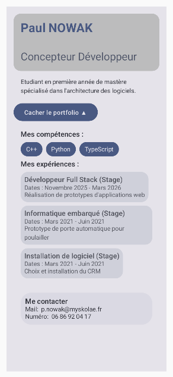
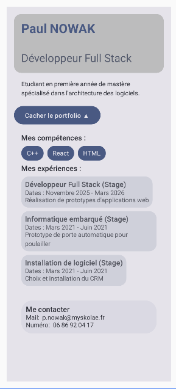
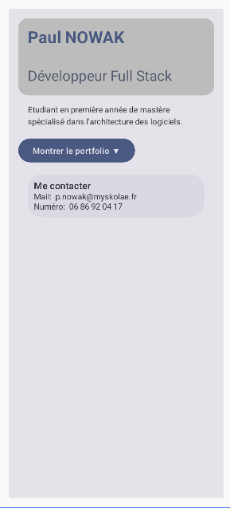

# Profil Développeur
 
## Description du projet
 
Dans ce devoir, on affiche la fiche profil d'un étudiant développeur afin de connaître des informations le concernant. En effet, elle est composée d'un en-tête avec le nom et le titre du développeur en question, d'une description courte de celui-ci, d'un bouton permettant d'afficher ou non son portfolio contenant ses compétences et ses expériences, et finalement d'une zone de contact incluant son mail et son numéro de téléphone.
 

 
L'écran possède 2 previews : une preview où les compétences sont montrées, et une autre où les compétences sont masquées.
 

 

 
## Composition du projet
 
### ProfilDeveloppeurTheme
 
Le thème du projet s'intitule **ProfilDeveloppeurTheme** : c'est lui qui gère l'apparence générale de l'application et qui contient le **Scaffold** (l'échafaudage) qui s'occupera de la structure de base de l'écran. Il est étoffé davantage dans le fichier **Theme.kt**.
 
#### ColorScheme
 
Le **ColorScheme** est séparé en 2 familles : **LightColorScheme** et **DarkColorScheme**, qui définissent les couleurs respectivement pour les modes jour et nuit de l'application, afin de faciliter l'interface. Malheureusement, et par manque de temps, seule la version **jour** peut être testée.
 
Des couleurs majoritairement **bleues** sont utilisées, notamment pour souligner l'importance du **nom** du profil, ainsi que le bouton pour afficher/cacher le **Portfolio** et les différents jetons **Compétences**.
 
#### ProductShapes
 
Les **shapes** de certains composants, comme la surface des jetons **compétences** ou celle des différentes **expériences**, sont gérées dans **ProductShapes**, qui gère les coins des bordures et les paddings internes.
 
#### ProductTypography
 
La typographie est gérée dans le fichier **Type.kt**, avec **ProductTypography** qui classe les différents styles de texte avec des tailles de texte et des fontWeight différents, que ce soit pour le titre du développeur ou simplement pour une description.
 
### Les différents composables
 
L'arbre de composition suivant montre la hiérarchie des différents composables du projet :
 
```
DeveloperScreen
└── DeveloperFile
    ├── Surface
    └── DeveloperFileContent
        └── Column
            ├── DeveloperHeading
            │   └── Surface
            │      └── Column
            │          ├── DeveloperName
            │          │   └── Text
            │          └── DeveloperTitle
            │              └── Text
            ├── DeveloperDescription
            │   └── Text
            ├── Button
            │   └── Text
            ├── DeveloperPortfolio
            │   └── Column
            │       ├── DeveloperSkillsList
            │       │    └── Column
            │       │        ├── Text
            │       │        ├── Spacer
            │       │        └── LazyRow
            │       │            └── items (DeveloperSkillChip)
            │       │                └── Surface
            │       │                    └── Text
            │       ├── Spacer
            │       └── ExperienceSection
            │           └── Column
            │               ├── Text
            │               ├── Spacer
            │               └── LazyColumn
            │                    └── items (ExperienceCard)
            │                        └── Card
            │                            └── Column
            │                                ├── Text
            │                                ├── Text
            │                                └── Text
            └── ContactZone
                └── Box
                    └── Column
                        └── Surface
                            ├── Text
                            ├── DeveloperMail
                            │   └── Text
                            └── DeveloperPhoneNumber
                                └── Text
```
 
Concernant les différents composables :
 
#### DeveloperScreen
 
Il s'agit simplement du premier écran de l'application : il a un simple modifier comme paramètre, et son enfant est un composant **DeveloperFile** (avec un padding externe de 1- dp) qu'il faudra paramétrer lors de son appel.
 
#### DeveloperFile
 
Il représente la fiche de profil et est séparé en 2 parties : une Surface pour gérer le conteneur cliquable (via **onFileClick**) sur la carte, et un composant DeveloperFileContent pour l'organisation interne.
 
#### DeveloperFileContent
 
Comme dit précédemment, il gère l'organisation interne de son composant parent **DeveloperFile** et prend tous ses paramètres à l'exception de **onFileClick**.
 
Il contient un conteneur de type **Column** qui contient lui-même 5 composants : **DeveloperHeading**, **DeveloperDescription**, un bouton pour cacher le portfolio, **DeveloperPortfolio** (seulement si le booléen **isShown** est true) et **ContactZone**.
 
#### DeveloperHeading
 
Ce composant représente l'en-tête du projet (avec le nom et le titre du développeur) et son modifier lui permet d'occuper la largeur maximale qui lui a été accordée.
 
Il contient une **Surface** de couleur LightGray, puis un **Column** qui contient un **DeveloperName** et un **DeveloperTitle**.
 
#### DeveloperName
 
Comme son nom l'indique, il affiche le nom du développeur. Par défaut, il a une couleur rouge et un fontSize de 35 sp.
 
#### DeveloperTitle
 
Comme son nom l'indique, il affiche le titre du développeur. Par défaut, il a un FontWeight Bold et un fontSize de 35 sp.
 
#### DeveloperDescription
 
Ce composant affiche une présentation du développeur sous forme de texte. Par défaut, il occupe sa largeur maximale, a un padding externe de 12 dp et un fontSize de 20 sp.
 
#### DeveloperPortfolio
 
Cet élément important permet de gérer tout ce qui concerne le parcours du développeur, soit ses compétences et ses expériences.
 
En effet, son enfant est un conteneur **Column** qui contient lui-même plusieurs éléments : **DeveloperSkillsList**, un **Spacer**, et **ExperienceSection**.
 
#### DeveloperSkillsList
 
Ce composant gère la liste complète des compétences connues du développeur. Son enfant est un conteneur **Column** possédant plusieurs éléments à la suite :
- un **Text**
- un **Spacer**
- un **LazyRow**, qui contiendra comme items un groupe de plusieurs composants **DeveloperSkillChip**.
#### DeveloperSkillChip
 
Ce composant contient une **Surface** qui contient elle-même un **Text** pour afficher une compétence en particulier.
 
#### ExperienceSection
 
Ce composant gère la liste des expériences contenues dans le portfolio du développeur. Son enfant est un conteneur **Column** possédant plusieurs éléments à la suite :
- un **Text**
- un **Spacer**
- un **LazyColumn**, qui contiendra comme items un groupe de plusieurs composants **ExperienceCard**.
#### ExperienceCard
 
Centré sur l'affichage d'une expérience du développeur, ce composant contient une **Card** qui contient elle-même un **Column** qui rassemble 3 enfants **Text** pour montrer le titre de l'expérience, ses dates et sa description.
 
#### ContactZone
 
Ce composant est focalisé sur les données de contact du développeur : il contient une **Surface** avec un **Column** contenant un **Text**, **DeveloperMail** et **DeveloperPhoneNumber**.
 
#### DeveloperMail
 
Ce composant affiche un **Text** représentant le mail de contact du développeur.
 
#### DeveloperPhoneNumber
 
Ce composant affiche un **Text** représentant le numéro de téléphone du développeur.
 
## Quelles notions du chapitre Compose UI avez-vous réutilisées dans cette application ?
 
J'ai utilisé les **LazyRow**, les **LazyColumn**, les **Card**, les **Spacer** et les **Box**.
 
